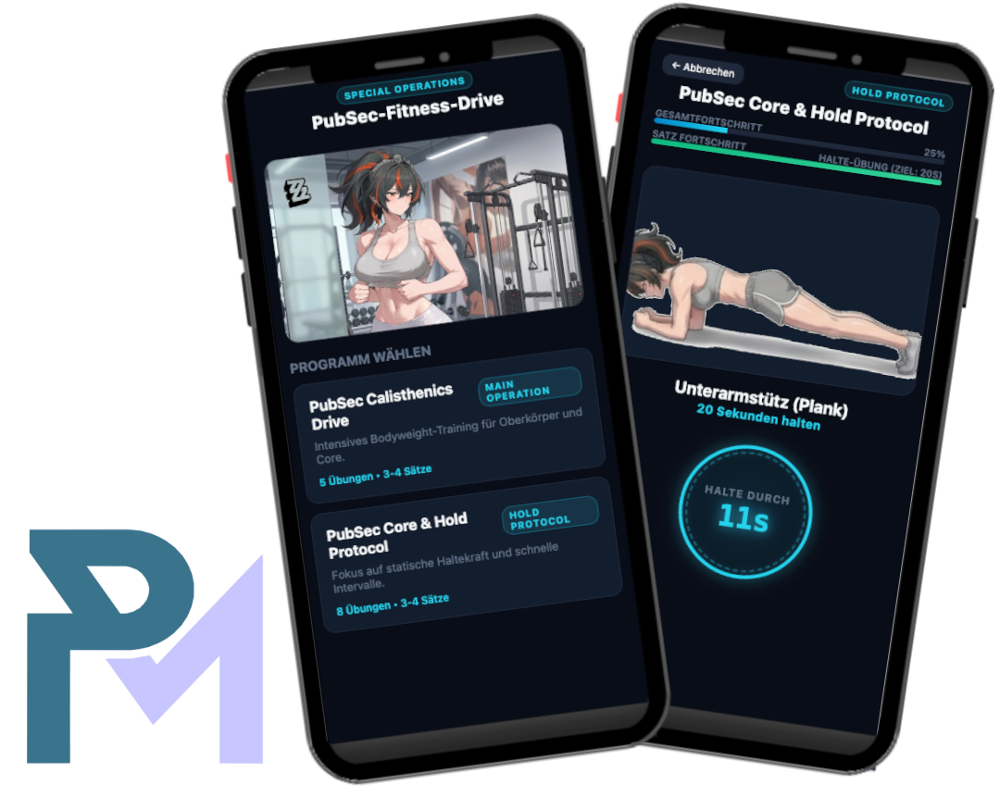

<h2 align="center">
  PubSec-Fitness-Drive 🛡️⚡<br/>
  <a href="https://github.com/KingPaulus" target="_blank">King Paulus</a>
</h2>
<div align="center">
  
</div>

<br/>

<center>

[](https://forthebadge.com) &nbsp;
[](https://forthebadge.com) &nbsp;
[](https://forthebadge.com) &nbsp;


Eine mobile-optimierte, progressive Web-App (PWA) für Fitness-Protokolle und Bodyweight-Training, inspiriert vom futuristischen Cyberpunk- / PubSec-Aesthetic (*Zenless Zone Zero*).

Die App wurde speziell für die Nutzung auf Smartphones (optimiert für **iPhone 15**) entwickelt. Sie kommt komplett **ohne Backend** aus und läuft direkt als performante, statische Web-Anwendung.

---

## 🚀 Features

- **Cyberpunk / Cyan-Glow Interface:** Hochwertiges, dunkles Sci-Fi-Theme mit custom Animationen und dem interaktiven "Core Drive" Button.
- **Duale Fortschrittsanzeige:** Visualisierung des Gesamtfortschritts über die komplette Trainingseinheit sowie des aktuellen Satz-Fortschritts.
- **Flexible Trainingstypen:**
    - **Satz-basierte Übungen (`reps`):** Unterstützung dynamischer Satzfolgen mit der Option, spontan einen 4. Extra-Satz hinzuzufügen.
    - **Zeit-basierte Übungen (`hold`):** Integrierter Countdown-Timer für statische Halte-Übungen (z. B. Plank, L-Sit) mit direktem Übergang in die Pause.
- **Dynamischer Pause-Modus:** Variable Pausenzeiten (60s / 90s) mit zufällig wechselnden Recovery-Screens.
- **PWA-Ready:** Kann direkt auf dem Home-Screen deines iPhones als App installiert werden.

---

## 📁 Projektstruktur

```text
PubSec-Fitness-Drive/
├── index.html            # Hauptmenü & Programm-Auswahl
├── workout.html          # Aktiver Workout-Screen mit Timer & Progress
├── css/
│   └── style.css         # ZZZ/PubSec Dark Theme CSS (Optimiert für iPhone 15)
├── js/
│   ├── components.js     # Dynamische Komponenten (Meta-Tags, Favicons, Footer)
│   ├── programs.js       # Datenbasis & Konfiguration aller Trainingsprogramme
│   ├── main.js           # Logik für das Hauptmenü & Programmauswahl
│   └── workout.js        # Workout-Engine (Timer, Set-Progression, UI-State)
├── public/               # Assets (Übungsbilder, Pausenbilder, Favicons)
│   ├── pause1.png
│   ├── pause2.png
│   ├── pause3.png
│   └── favicon/
└── README.md             # Projekt-Dokumentation
```

---

## 🛠️ Anleitung: Neue Übungen & Programme hinzufügen

Das gesamte Training wird zentral über die Datei `js/programs.js` gesteuert. Du musst keine HTML-Dateien anpassen, um neue Programme oder Übungen hinzuzufügen.

### 1. Bilder ablegen
Lege das Bild für deine neue Übung im Ordner `public/` ab (z. B. `public/meine_uebung.png`).

### 2. Eintrag in `js/programs.js` anpassen
Öffne `js/programs.js` und erstelle ein neues Programm oder ergänze ein bestehendes:

```javascript
const fitnessPrograms = [
    {
        id: "mein-custom-workout",
        title: "Special Ops Core Drive",
        description: "Intensives Core- und Stabilisationstraining.",
        badge: "OPERATION",
        exercises: [
            // Typ A: Übung mit Wiederholungen & Sätzen
            { 
                name: "Klimmzüge", 
                target: "6 - 10 Wiederholungen", 
                type: "reps", 
                sets: 3, 
                allowOptional: true, 
                image: "public/klimmzuege.png" 
            },

            // Typ B: Übung auf Zeit (Halte-Übung)
            { 
                name: "Unterarmstütz (Plank)", 
                target: "20 Sekunden halten", 
                type: "hold", 
                holdSeconds: 20, 
                sets: 1, 
                allowOptional: false, 
                image: "public/plank.png" 
            }
        ]
    }
];
```

### Parameter-Erklärung für Übungen:

| Parameter | Typ | Beschreibung |
| :--- | :--- | :--- |
| `name` | String | Name der Übung (z. B. `"Liegestützen"`). |
| `target` | String | Anzeigetext für das Übungsziel (z. B. `"10 - 15 Wiederholungen"` oder `"20 Sekunden halten"`). |
| `type` | String | `"reps"` für Standard-Sätze oder `"hold"` für Zeit-Countdowns. |
| `sets` | Number | Anzahl der vorgesehenen Sätze (z. B. `3` oder `1`). |
| `allowOptional` | Boolean | `true`, wenn nach Satz 3 ein optinaler 4. Satz angeboten werden darf. |
| `holdSeconds` | Number | *(Nur bei `type: "hold"`)* Dauer des Timers in Sekunden. |
| `image` | String | Relativer Pfad zum Bild im `public/`-Ordner. |

---

## 📱 Mobile Nutzung & Deployment (Vercel)

### Deployment
Da die Anwendung aus reinem HTML, CSS und JavaScript besteht, kann sie ohne Build-Prozess directly auf **Vercel**, **GitHub Pages** oder **Netlify** gehostet werden.

1. Repository auf GitHub pushen.
2. Projekt in Vercel importieren.
3. Fertig! Die Live-URL steht sofort zur Verfügung.

### Auf dem iPhone (iOS) installieren
1. Öffne die Live-URL in **Safari** auf deinem iPhone 15.
2. Tippe auf den **Teilen-Button** (Quadrat mit Pfeil nach oben).
3. Wähle **"Zum Home-Bildschirm"**.
4. Die App startet nun wie eine native App ohne Browser-Leisten im Vollbildmodus.

---

*PUBSEC SPECIAL OPERATIONS • NEW ERIDU DIVISION*